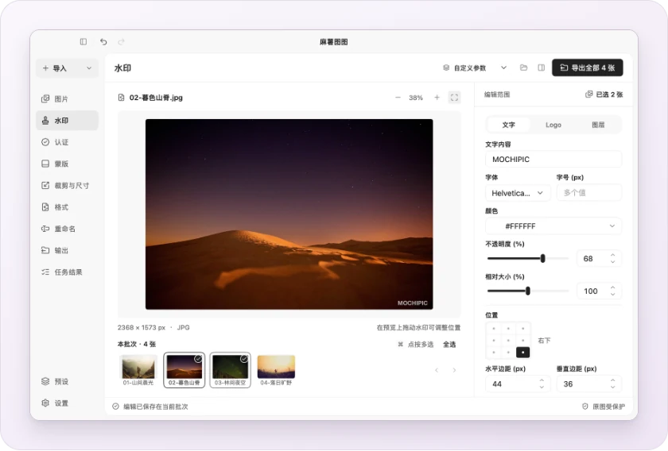

<p align="center">
  <a href="docs/assets/workspace-crop.webp">
    <picture>
      <source media="(prefers-color-scheme: dark)" srcset="docs/assets/mochipic-cover-dark.webp">
      
    </picture>
  </a>
</p>

<h1 align="center">Fine-tune each photo. Export the whole batch.</h1>

<p align="center">A native batch image editor for macOS and Windows. Your images stay on your device.</p>

<p align="center">
  <a href="https://github.com/luzhenhua/mochipic/releases/download/v0.0.26/MochiPic-0.0.26-arm64-en.dmg"></a>
  &nbsp;
  <a href="https://github.com/luzhenhua/mochipic/releases/download/v0.0.26/MochiPic-0.0.26-windows-x64-setup.exe"></a>
  <br>
  <sub>macOS 13+ · Apple Silicon &nbsp; / &nbsp; Windows 10/11 · x64</sub>
</p>

<p align="center">
  <strong>English</strong> · <a href="docs/readme/zh-Hans.md">简体中文</a> · <a href="docs/readme/ja.md">日本語</a> · <a href="docs/readme/es.md">Español</a> · <a href="docs/readme/fr.md">Français</a> · <a href="docs/readme/pt-BR.md">Português (Brasil)</a>
  <br>
  <sub><a href="https://mochipic.zhenhua.lu/">Website</a> · <a href="https://github.com/luzhenhua/mochipic/releases/latest">All downloads</a> · <a href="docs/USAGE.md">User guide (简体中文)</a></sub>
</p>

## What you can do

### Edit the photos you select

Crop and resize a single photo, make a collage, or apply a watermark to several photos at once. Each photo keeps its own settings.

[](docs/assets/workspace-watermark.webp)

### Export the whole batch

Convert formats, rename files, and export in one pass. Your originals stay intact.

[](docs/assets/workspace-export.webp)

## Development and contributions

Built with Go, MyGo, Lobe MyGo, and libvips. Run the development build on an Apple Silicon Mac with the following commands.

```sh
scripts/setup-native.sh
scripts/go.sh run ./cmd/imageflow
```

[macOS and Windows build guide (简体中文)](docs/DEVELOPMENT.md) · [Architecture (简体中文)](docs/ARCHITECTURE.md)

[Issues](https://github.com/luzhenhua/mochipic/issues) · [Contribution guide](CONTRIBUTING.md)

## License

MochiPic is free for personal, noncommercial use. Business and organizational use, including internal work, requires written authorization.

[Personal Use License](LICENSE.md) · [Contact for commercial licensing](https://zhenhua.lu/)

## Credits

Designed and developed by [Zhenhua Lu](https://zhenhua.lu). Thanks to Lobe UI, Lobe MyGo, MyGo, and the open-source projects behind MochiPic.

[Third-party notices](docs/THIRD_PARTY.md)
