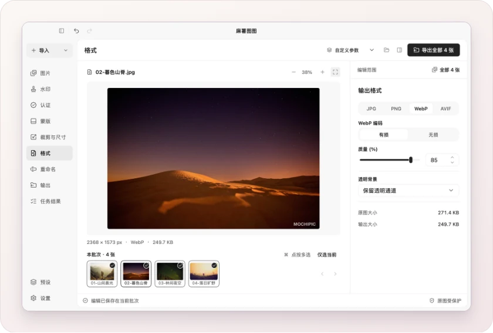

<p align="center">
  <a href="../assets/workspace-crop.webp">
    <picture>
      <source media="(prefers-color-scheme: dark)" srcset="../assets/mochipic-cover-dark.webp">
      
    </picture>
  </a>
</p>

<h1 align="center">Ajustez chaque photo. Exportez tout le lot.</h1>

<p align="center">Application native de traitement d’images par lots pour macOS et Windows. Vos images restent sur votre appareil.</p>

<p align="center">
  <a href="https://github.com/luzhenhua/mochipic/releases/download/v0.0.26/MochiPic-0.0.26-arm64-fr.dmg"></a>
  &nbsp;
  <a href="https://github.com/luzhenhua/mochipic/releases/download/v0.0.26/MochiPic-0.0.26-windows-x64-setup.exe"></a>
  <br>
  <sub>macOS 13 ou version ultérieure · Apple Silicon &nbsp; / &nbsp; Windows 10/11 · x64</sub>
</p>

<p align="center">
  <a href="../../README.md">English</a> · <a href="zh-Hans.md">简体中文</a> · <a href="ja.md">日本語</a> · <a href="es.md">Español</a> · <strong>Français</strong> · <a href="pt-BR.md">Português (Brasil)</a>
  <br>
  <sub><a href="https://mochipic.zhenhua.lu/">Site officiel</a> · <a href="https://github.com/luzhenhua/mochipic/releases/latest">Tous les téléchargements</a> · <a href="../USAGE.md">Guide d’utilisation (简体中文)</a></sub>
</p>

## Fonctions principales

### Modifiez les photos sélectionnées

Recadrez ou redimensionnez une photo, créez un collage ou ajoutez un filigrane à plusieurs photos. Chacune conserve ses réglages.

[](../assets/workspace-watermark.webp)

### Exportez le lot entier

Convertissez les formats, renommez les fichiers et exportez-les en une seule opération. Les originaux restent intacts.

[](../assets/workspace-export.webp)

## Développement et contributions

MochiPic utilise Go, MyGo, Lobe MyGo et libvips. Sur un Mac avec puce Apple, lancez la version de développement avec les commandes suivantes.

```sh
scripts/setup-native.sh
scripts/go.sh run ./cmd/imageflow
```

[Guide de compilation pour macOS et Windows (简体中文)](../DEVELOPMENT.md) · [Architecture (简体中文)](../ARCHITECTURE.md)

[Signaler un problème](https://github.com/luzhenhua/mochipic/issues) · [Guide de contribution](../../CONTRIBUTING.md)

## Remerciements

Conçu et développé par [Zhenhua Lu](https://zhenhua.lu). Merci à Lobe UI, Lobe MyGo, MyGo et aux projets libres qui rendent MochiPic possible.

[Licences des composants tiers](../THIRD_PARTY.md)
