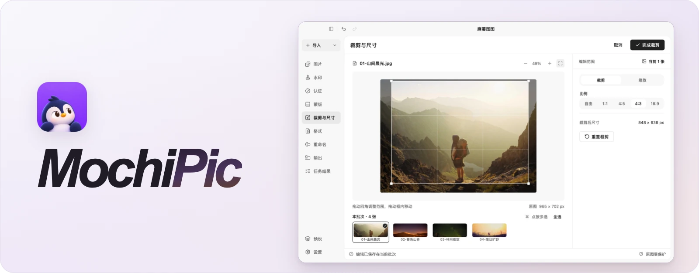

<p align="center">
  <a href="../assets/workspace-crop.webp">
    <picture>
      <source media="(prefers-color-scheme: dark)" srcset="../assets/mochipic-cover-dark.webp">
      
    </picture>
  </a>
</p>

<h1 align="center">Ajuste cada foto. Exporte o lote inteiro.</h1>

<p align="center">Editor nativo de imagens em lote para macOS e Windows. Suas imagens ficam no seu dispositivo.</p>

<p align="center">
  <a href="https://github.com/luzhenhua/mochipic/releases/download/v0.0.26/MochiPic-0.0.26-arm64-pt-BR.dmg"></a>
  &nbsp;
  <a href="https://github.com/luzhenhua/mochipic/releases/download/v0.0.26/MochiPic-0.0.26-windows-x64-setup.exe"></a>
  <br>
  <sub>macOS 13 ou posterior · Apple Silicon &nbsp; / &nbsp; Windows 10/11 · x64</sub>
</p>

<p align="center">
  <a href="../../README.md">English</a> · <a href="zh-Hans.md">简体中文</a> · <a href="ja.md">日本語</a> · <a href="es.md">Español</a> · <a href="fr.md">Français</a> · <strong>Português (Brasil)</strong>
  <br>
  <sub><a href="https://mochipic.zhenhua.lu/">Site oficial</a> · <a href="https://github.com/luzhenhua/mochipic/releases/latest">Todos os downloads</a> · <a href="../USAGE.md">Guia de uso (简体中文)</a></sub>
</p>

## Principais recursos

### Edite as fotos selecionadas

Recorte ou redimensione uma foto, monte uma colagem ou aplique uma marca d’água a várias fotos de uma vez. Cada foto mantém seus próprios ajustes.

[](../assets/workspace-watermark.webp)

### Exporte o lote inteiro

Converta os formatos, renomeie os arquivos e exporte tudo de uma vez. Os originais ficam intactos.

[](../assets/workspace-export.webp)

## Desenvolvimento e contribuições

O MochiPic usa Go, MyGo, Lobe MyGo e libvips. Para abrir a versão de desenvolvimento em um Mac com Apple Silicon, execute os comandos abaixo.

```sh
scripts/setup-native.sh
scripts/go.sh run ./cmd/imageflow
```

[Guia de compilação para macOS e Windows (简体中文)](../DEVELOPMENT.md) · [Arquitetura (简体中文)](../ARCHITECTURE.md)

[Relatar um problema](https://github.com/luzhenhua/mochipic/issues) · [Guia de contribuição](../../CONTRIBUTING.md)

## Créditos

Design e desenvolvimento por [Zhenhua Lu](https://zhenhua.lu). Agradecemos ao Lobe UI, ao Lobe MyGo, ao MyGo e aos projetos de código aberto que dão suporte ao MochiPic.

[Licenças de terceiros](../THIRD_PARTY.md)
